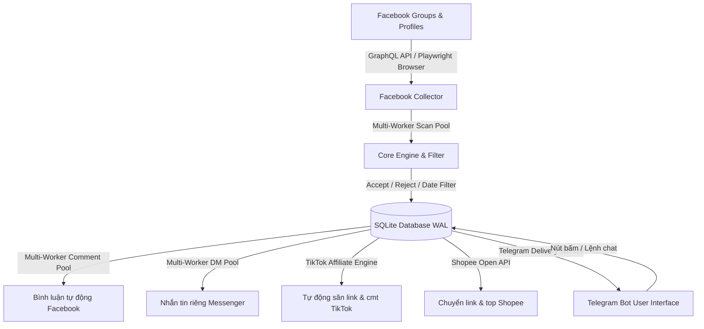

# TỔNG HỢP VÀ THỐNG KÊ TOÀN BỘ CHỨC NĂNG HỆ THỐNG BOT

> **Hệ thống:** Facebook Automated Monitor, Interaction & Affiliate Bot  
> **Kiến trúc:** Node.js (ESM), Playwright / Comet GraphQL API, SQLite (WAL mode), Telegram Bot API (GrammY), Electron Desktop App.  
> **Cập nhật gần nhất:** Tháng 10/2026.

---

## MỤC LỤC
1. [Tổng Quan Kiến Trúc Hệ Thống](#1-tổng-quan-kiến-trúc-hệ-thống)
2. [Module Thu Thập Dữ Liệu Facebook (Collector & Scraper)](#2-module-thu-thập-dữ-liệu-facebook-collector--scraper)
3. [Module Bộ Lọc Nội Dung (Keyword Accept, Keyword Reject & Date Range)](#3-module-bộ-lọc-nội-dung-keyword-accept-keyword-reject--date-range)
4. [Module Xử Lý Đa Luồng & Bất Đồng Bộ Tốc Độ Cao (Concurrency Engine)](#4-module-xử-lý-đa-luồng--bất-đồng-bộ-tốc-độ-cao-concurrency-engine)
5. [Module Tương Tác Facebook: Bình Luận & Tin Nhắn Riêng (Comments & Direct Messages)](#5-module-tương-tác-facebook-bình-luận--tin-nhắn-riêng-comments--direct-messages)
6. [Module Tiếp Thị Liên Kết (Shopee & TikTok Affiliate Marketing)](#6-module-tiếp-thị-liên-kết-shopee--tiktok-affiliate-marketing)
7. [Module Giao Diện Người Dùng (Telegram Bot & Desktop App)](#7-module-giao-diện-người-dùng-telegram-bot--desktop-app)
8. [Module Cơ Sở Dữ Liệu & Cách Ly Quyền Riêng Tư (Database & Storage)](#8-module-cơ-sở-dữ-liệu--cách-ly-quyền-riêng-tư-database--storage)
9. [Bảng Tra Cứu Toàn Bộ Lệnh Telegram Bot (Command Cheat Sheet)](#9-bảng-tra-cứu-toàn-bộ-lệnh-telegram-bot-command-cheat-sheet)
10. [Bảng Cấu Hình Biến Môi Trường (.env)](#10-bảng-cấu-hình-biến-môi-trường-env)

---

## 1. TỔNG QUAN KIẾN TRÚC HỆ THỐNG

Hệ thống là giải pháp toàn diện cho việc:
- **Giám sát thời gian thực:** Theo dõi tự động các Nhóm (Groups) và Trang cá nhân (Profiles) trên Facebook.
- **Lọc bài viết thông minh:** Phân loại bài viết chính xác bằng bộ đôi từ khóa **Accept (nhận)** và **Reject (chặn)** cùng bộ lọc ngày giờ.
- **Tự động hóa hành động:** Tự động bình luận, tự động gửi tin nhắn riêng Messenger cho tác giả bài viết.
- **Tối ưu hóa doanh thu:** Tự động săn bài viết tiềm năng và rải link tiếp thị liên kết (Shopee Affiliate & TikTok Shop Affiliate).
- **Vận hành tốc độ cao:** Đa luồng (multi-worker), bất đồng bộ (async), ưu tiên API GraphQL trực tiếp thay vì render DOM nặng nề.



---

## 2. MODULE THU THẬP DỮ LIỆU FACEBOOK (COLLECTOR & SCRAPER)

### 2.1. Đa dạng hóa nguồn theo dõi
- **Nhóm Facebook (Groups):** Quét các nhóm công khai hoặc nhóm kín mà tài khoản Facebook của bot đã tham gia.
- **Trang cá nhân (Profiles):** Quét bài viết trên dòng thời gian cá nhân hoặc chia sẻ của người dùng.
- **Lựa chọn loại nội dung trang cá nhân:**
  - `posts`: Chỉ quét bài viết thông thường.
  - `reels`: Chỉ quét grid Reels video ngắn.
  - `all`: Quét đồng thời cả bài viết và Reels.
- **Tự động lấy nhóm đã tham gia (`/joined`):** Tự động phát hiện danh sách nhóm mà tài khoản đang tham gia và cho phép chọn hàng loạt qua `/select`.

### 2.2. Trích xuất thông tin bài viết chi tiết
- **ID & Permalink bài viết:** Tự động chuẩn hóa link chuẩn `https://www.facebook.com/groups/GROUP_ID/posts/POST_ID`. Giải mã các dạng link rút gọn, hover tooltip permalink.
- **Thời gian đăng bài chính xác:** Trích xuất datetime ISO chính xác (kể cả tooltip trễ, BigPipe script tags, HTML time tags).
- **Thông tin tác giả:** Lấy tên người đăng, link trang cá nhân (author URL).
- **Phát hiện tác giả ẩn danh:** Tự động nhận diện bài đăng Người tham gia ẩn danh (Anonymous Participant / Anonymous Group Member) để chặn các hành vi gửi tin nhắn riêng vô nghĩa.
- **Media đính kèm:** Tự động bóc tách và tải ảnh / video (tối đa 10 mục) gửi về Telegram dưới dạng album.

### 2.3. Cơ chế Facebook GraphQL / BigPipe API trực tiếp (`facebook-api.js`)
- Bỏ qua việc tải full trang DOM/HTML/CSS nặng nề.
- Đọc BigPipe streaming chunks và các payload `comet_sections`.
- Giúp tốc độ phản hồi nhanh hơn gấp 5 - 10 lần, giảm 80% RAM và CPU.

### 2.4. Cơ chế chống khóa tài khoản & Phục hồi lỗi
- **Xóa bỏ thời gian chờ 6 giờ cố định:** Không còn bị khóa cứng 6 giờ khi gặp cảnh báo tạm thời; hỗ trợ thăm dò probe liên tục để phục hồi ngay khi Facebook mở lại.
- **Lệnh `/unblock`:** Mở khóa cooldown tức thì và xóa toàn bộ thông báo lỗi để kích hoạt quét lại ngay lập tức.
- **Xác thực phiên đăng nhập:** Tự động kiểm tra cookie `c_user`, báo lỗi đăng nhập rõ ràng nếu cookie hết hạn.

---

## 3. MODULE BỘ LỌC NỘI DUNG (KEYWORD ACCEPT, KEYWORD REJECT & DATE RANGE)

Hệ thống trang bị bộ lọc nội dung 2 lớp (Dual-layer Keyword Filter) và bộ lọc thời gian:

```
[Bài viết mới] 
       │
       ▼
[Chứa từ khóa Reject?] ──(CÓ)──► [LOẠI BỎ NGAY LẬP TỨC]
       │ (KHÔNG)
       ▼
[Khớp từ khóa Accept?] ──(KHÔNG)──► [BỎ QUA]
       │ (CÓ hoặc Accept để trống)
       ▼
[Nằm trong khoảng ngày?] ──(KHÔNG)──► [BỎ QUA]
       │ (CÓ hoặc DateRange để trống)
       ▼
[LƯU & ĐẨY VÀO HÀNG ĐỢI XỬ LÝ (Telegram / Comment / Inbox / TikTok)]
```

### 3.1. Từ khóa nhận (Keyword Accept / Whitelist)
- Bài viết phải chứa **ít nhất 1 từ khóa** trong danh sách Accept.
- Nếu danh sách Accept để trống hoặc đặt là `off` -> chấp nhận mọi bài viết (không bị Reject chặn).
- Cài đặt mặc định cho toàn tài khoản: `/accept từ 1; từ 2` hoặc `/keywords từ 1; từ 2`.
- Cài đặt riêng cho từng nguồn: `/groupaccept ID từ 1; từ 2` hoặc `/groupkeywords ID từ 1; từ 2`.

### 3.2. Từ khóa loại trừ (Keyword Reject / Blacklist)
- **Ưu tiên hàng đầu:** Nếu bài viết chứa **bất kỳ từ khóa nào** trong danh sách Reject, bài viết bị loại bỏ ngay lập tức (kể cả khi có chứa từ Accept).
- Ngăn chặn triệt để bài viết rác: vay tiền, lừa đảo, cờ bạc, tuyển dụng ảo, môi giới trung gian,...
- Cài đặt mặc định cho toàn tài khoản: `/reject từ 1; từ 2`.
- Cài đặt riêng cho từng nguồn: `/groupreject ID từ 1; từ 2`.

### 3.3. Chuẩn hóa tiếng Việt cao cấp
- Khử dấu tiếng Việt tự động (`đ/d`, Unicode Normalization NFD).
- Không phân biệt hoa/thường, không phân biệt khoảng trắng thừa.
- Khớp dạng chuỗi con (substring): `vay tien` chặn được cả `VAY TIỀN`, `Cho vay tiền nhanh`, `vay tiền online`.

### 3.4. Bộ lọc khoảng ngày đăng (`/daterange`)
- Lọc theo ngày đăng thực tế của bài viết (giờ Việt Nam UTC+7):
  - Lọc khoảng: `/daterange ID 01/10/2026 10/10/2026`
  - Lọc từ một mốc đến nay: `/daterange ID 01/10/2026`
  - Lọc chi tiết đến giờ: `/daterange ID 01/10/2026 08:00:00 10/10/2026 18:00:00`
  - Tắt lọc ngày: `/daterange ID off`

---

## 4. MODULE XỬ LÝ ĐA LUỒNG & BẤT ĐỒNG BỘ TỐC ĐỘ CAO (CONCURRENCY ENGINE)

Toàn bộ hệ sinh thái đã được chuyển đổi từ mô hình tuần tự đơn luồng (sequential single-thread) sang **mô hình đa worker song song (concurrent worker pools)**:

### 4.1. Scan Worker Pool (Quét nguồn song song)
- Cấu hình qua `SCAN_WORKERS` (từ 1 đến 4 luồng song song, mặc định 4).
- 4 luồng quét độc lập chia sẻ danh sách nguồn đến hạn quét (`dueGroups`).
- Rút ngắn độ trễ khởi động từ 1500ms xuống chỉ còn 250ms giữa các luồng.

### 4.2. Comment Worker Pool (Bình luận song song)
- Cấu hình qua `COMMENT_WORKERS` (từ 1 đến 8 luồng song song, mặc định 2 - 4 luồng).
- **Xóa bỏ khoảng chờ 30 giây cứng giữa các cmt:** Rút ngắn xuống cấu hình động `COMMENT_INTERVAL_SECONDS` (1s - 2s).
- Nâng cấp `#commentQueue` trong Playwright context thành đa luồng (`Math.max(4, commentWorkers)`), cho phép mở song song nhiều tab thao tác đồng thời.
- Cơ chế đánh thức sự kiện đồng thời (`Set` multi-waker listeners) đánh thức toàn bộ các worker đang ngủ ngay khi có bài viết cần cmt.

### 4.3. Direct Message Worker Pool (Nhắn tin riêng song song)
- Cấu hình qua `DIRECT_MESSAGE_WORKERS` (từ 1 đến 8 luồng song song, mặc định 2 luồng).
- Giãn cách linh hoạt `DIRECT_MESSAGE_INTERVAL_SECONDS`.
- Đánh thức worker song song khi có công việc inbox mới.

### 4.4. Đảm bảo an toàn dữ liệu với SQLite WAL Mode
- SQLite hoạt động ở chế độ Write-Ahead Logging (`PRAGMA journal_mode=WAL`), `busy_timeout=5000`.
- Chuyển trạng thái hàng đợi theo cơ chế atomic (`state = 'sending'`), đảm bảo tuyệt đối không có việc 2 worker lấy trùng một bài viết hay gửi trùng tin nhắn.

---

## 5. MODULE TƯƠNG TÁC FACEBOOK: BÌNH LUẬN & TIN NHẮN RIÊNG (COMMENTS & DIRECT MESSAGES)

### 5.1. Bình luận Facebook (Comments)
- **Tự động bình luận (`/autoreply`):**
  - Tự động đăng bình luận lên các bài viết mới xuất hiện sau thời điểm bật và thỏa mãn bộ lọc.
  - Cú pháp: `/autoreply ID nội dung` hoặc `/autoreply all nội dung`. Tắt bằng `/autoreply ID off`.
- **Bình luận thủ công một nội dung (`/comment`):**
  - Cú pháp: `/comment ID_nguồn ID_bài | nội dung bình luận`.
  - Hỗ trợ chọn nhiều bài: `/comment ID 123,456 | nội dung`.
  - Hỗ trợ toàn bộ bài trong nguồn: `/comment ID all | nội dung`.
- **Bình luận danh sách nhiều link (`/commentlist`):**
  - Cú pháp: `/commentlist ID ID_bài |` kèm mỗi dòng một link/nội dung riêng biệt.
  - Bot sẽ tạo từng bình luận riêng lẻ cho từng dòng (rất thích hợp cho rải link affiliate).
- **Nút bấm dưới từng tin bài Telegram:**
  - Nút **`💬 Bình luận`**: Nhập nhanh 1 bình luận.
  - Nút **`📋 Danh sách bình luận`**: Nhập danh sách nhiều dòng.
- **Quản lý hàng đợi bình luận:**
  - `/comments`: Xem trạng thái 20 bình luận gần nhất (chờ, thành công, lỗi).
  - `/cancelcomments ID|all`: Hủy ngay các bình luận đang nằm trong hàng đợi chờ.

### 5.2. Nhắn tin riêng Messenger (Direct Messages / Inbox)
- **Tự động nhắn tin riêng (`/autoinbox`):**
  - Tự động mở Messenger và gửi tin nhắn riêng cho người đăng bài mới.
  - Hỗ trợ template biến: `{name}` (tên người đăng), `{link}` (link bài viết).
  - Cú pháp: `/autoinbox ID Chào {name}, mình quan tâm bài viết: {link}`. Tắt bằng `/autoinbox ID off`.
  - Chống nhắn tin cho bài viết ẩn danh (Anonymous).
- **Nhắn tin riêng thủ công (`/inbox`):**
  - Gửi tin nhắn trực tiếp từ Telegram: `/inbox ID ID_bài | nội dung`.
  - Hoặc bấm nút **`📩 Nhắn tin riêng`** dưới tin bài trên Telegram.
- **Giới hạn an toàn tài khoản:**
  - Tự động chống gửi trùng lặp tin nhắn cho cùng một tác giả.
  - Giới hạn tốc độ an toàn tránh checkpoint Facebook.
### 5.3. Kết bạn với người viết bài (Friend Request)
- **Tự động kết bạn (`/autofriend`):**
  - Tự động gửi lời mời kết bạn Facebook tới người đăng bài mới thỏa mãn bộ lọc từ khóa và khoảng ngày.
  - Cú pháp: `/autofriend ID on` hoặc `/autofriend all on` (Tắt bằng `off`).
  - Nút bật/tắt nhanh trong menu chi tiết nguồn `/settings ID`.
  - Tự động chống gửi trùng: Nếu đã gửi lời mời hoặc tác giả đã được kết bạn từ bài viết khác thì tự động bỏ qua.
  - Bỏ qua các bài viết ẩn danh (Anonymous).
- **Kết bạn thủ công một bài viết (`/friend`):**
  - Cú pháp: `/friend ID_nguồn ID_bài` hoặc reply trực tiếp tin bài trên Telegram rồi gõ `/friend`.
  - Nút bấm trực tiếp **`🤝 Kết bạn`** ngay dưới tin bài trên Telegram để gửi yêu cầu chỉ với 1 chạm.
- **Xử lý trạng thái kết bạn thông minh:**
  - `already_friends`: Phát hiện nếu đã là bạn bè từ trước.
  - `already_requested`: Phát hiện nếu lời mời đã được gửi trước đó và đang chờ đối phương chấp nhận.
  - `accepted`: Nếu đối phương đã gửi lời mời kết bạn cho bot trước đó, bot tự động nhấn "Xác nhận" để hoàn tất kết bạn.
  - `sent`: Gửi lời mời kết bạn mới thành công (thông qua GraphQL Relay Mutation tốc độ cao hoặc fallback DOM).
- **Quản lý hàng đợi kết bạn:**
  - `/friends` (hoặc `/friendstatus`): Xem 20 lời mời kết bạn gần nhất và trạng thái chi tiết.
  - `/cancelfriend ID|all`: Hủy các lời mời kết bạn đang chờ gửi.

---

## 6. MODULE TIẾP THỊ LIÊN KẾT (SHOPEE & TIKTOK AFFILIATE MARKETING)

### 6.1. Shopee Affiliate Marketing (Open API)
- **Tự động tìm top sản phẩm hoa hồng cao (`/affiliatetop`):**
  - Tìm kiếm sản phẩm theo tỷ lệ % hoa hồng (`rate`) hoặc số tiền hoa hồng (`amount`).
  - Hỗ trợ tìm kiếm theo từ khóa sản phẩm: `/affiliatetop 5 amount đồ gia dụng`.
- **Tự động cmt link Shopee top hoa hồng (`/affiliatetopcomment`):**
  - Tự động quét top và đăng từ 1 đến 20 bình luận chứa link `offerLink` Shopee vào bài viết.
  - Cú pháp: `/affiliatetopcomment ID_nguồn ID_bài 5 rate [từ khóa]`.
  - Nút bấm nhanh **`🛍 Bình luận top Shopee`** dưới bài viết trên Telegram để chọn số link (1, 3, 5, 10).
- **Chuyển đổi link Shopee thủ công (`/affiliate shopee`):**
  - Chuyển đổi hàng loạt link sản phẩm Shopee thông thường sang link tiếp thị liên kết (hỗ trợ tối đa 20 link/lần).
- **Quản lý link Shopee:**
  - `/affiliatelinks [trang]`: Xem danh sách link affiliate đã tạo và ID lưu trong máy.
  - `/affiliate status`: Xem trạng thái cấu hình khóa API Shopee.

### 6.2. TikTok Shop Affiliate (Creator Open API)
- **Kiểm tra trạng thái Creator:** `/tiktok status`, `/tiktok check`.
- **Chuyển đổi link sản phẩm TikTok (`/tiktok LINK1 LINK2`):** Tạo link tiếp thị TikTok Affiliate.
- **Xem top sản phẩm TikTok (`/tiktoktop`):**
  - Lọc theo % hoa hồng (`rate`) hoặc số tiền hoa hồng (`amount`): `/tiktoktop 5 rate gia dụng`.
- **Bình luận top TikTok lên bài viết Facebook (`/tiktoktopcomment`):**
  - Đăng link tiếp thị TikTok lên bài Facebook: `/tiktoktopcomment ID_nguồn ID_bài 5 rate [từ khóa]`.
  - Nút bấm nhanh **`🎵 Bình luận top TikTok`** dưới từng tin bài Telegram.
- **TIKTOK AUTO - Tự động hóa hoàn toàn từ quét bài đến đăng link TikTok:**
  - Cú pháp: `/tiktokauto ID SỐ_LINK [rate|amount] [từ khóa sản phẩm]`
  - Ví dụ: `/tiktokauto 1 5 rate đồ gia dụng`
  - Cơ chế: Khi nguồn Facebook #1 có bài mới xuất hiện khớp từ khóa, bot sẽ tự động gọi Creator API lấy 5 sản phẩm TikTok đồ gia dụng hoa hồng cao nhất và tự động cmt vào bài viết đó!
  - Tắt tự động: `/tiktokauto ID off`.

---

## 7. MODULE GIAO DIỆN NGƯỜI DÙNG (TELEGRAM BOT & DESKTOP APP)

### 7.1. Telegram Bot (Giao diện di động chính)
- **Menu Inline tương tác (/menu hoặc /start):**
  - Mở menu inline trực quan gồm 4 danh mục: Nguồn Facebook, Affiliate, Trang cá nhân, Bài viết đã lưu, Bình luận, Bộ lọc, Trạng thái, Hướng dẫn.
  - Thao tác hoàn toàn bằng nút bấm dưới tin nhắn (inline buttons), không làm rối khung chat.
- **Giao diện quản lý nguồn tương tác (`/sources`, `/settings ID`):**
  - Danh sách nguồn có phân trang trực quan.
  - Bấm vào nguồn để xem: Trạng thái chạy/dừng, Loại nguồn, Từ khóa Accept, Từ khóa Reject, Khoảng ngày, Trạng thái tự cmt, tự inbox, tự TikTok.
  - Các nút thao tác ngay:
    - `📄 Xem bài`: Xem các bài đã lưu của nguồn.
    - `🔄 Quét lại`: Kích hoạt lượt quét tức thì.
    - `▶️ Tiếp tục / ⏸ Tạm dừng`: Dừng hoặc chạy lại nguồn.
    - `🔤 Từ khóa nhận`: Cài đặt từ khóa Accept.
    - `🚫 Từ khóa chặn`: Cài đặt từ khóa Reject.
    - `📅 Khoảng ngày`: Cài đặt lọc ngày.
    - `Dùng từ khóa mặc định`: Khôi phục về bộ lọc mặc định.
    - `💬 Tự bình luận` & `📩 Tự nhắn tin`.
    - `🎵 TikTok tự động` & `Tắt TikTok tự động`.
- **Thẻ tin bài thông minh gửi về Telegram:**
  - Hiển thị tên nguồn, ID bài, ngày đăng, tên tác giả, link bài gốc Facebook, link trang cá nhân tác giả, từ khóa khớp.
  - Kèm theo 5 nút tương tác nhanh: `💬 Bình luận`, `📋 Danh sách bình luận`, `📩 Nhắn tin riêng`, `🛍 Top Shopee`, `🎵 Top TikTok`.

### 7.2. Desktop Application (Electron)
- Chạy ứng dụng trên Windows / macOS / Linux.
- Tự động quản lý tiến trình bot chạy ngầm.
- Giao diện trực quan xem logs thời gian thực.
- Quản lý file cấu hình `.env` trực tiếp trên form ứng dụng.
- Nút bấm mở trình duyệt để đăng nhập tài khoản Facebook an toàn qua Playwright persistent context (lưu cookie cục bộ trên máy người dùng, không bao giờ gửi cookie qua mạng).

---

## 8. MODULE CƠ SỞ DỮ LIỆU & CÁCH LY QUYỀN RIÊNG TƯ (DATABASE & STORAGE)

### 8.1. Cấu trúc cơ sở dữ liệu SQLite
- `users`: Quản lý người dùng được cấp phép, bộ lọc mặc định (`keywords_json`, `reject_keywords_json`).
- `groups`: Quản lý danh sách nguồn, URL, tên, trạng thái pause, bộ lọc riêng, cấu hình auto reply/inbox/tiktok.
- `posts`: Lưu trữ dữ liệu bài viết Facebook đã thu thập, timestamp, dữ liệu JSON trích xuất.
- `deliveries`: Quản lý hàng đợi gửi thông báo tin bài về Telegram kèm cơ chế retry chống rate-limit.
- `media_deliveries`: Hàng đợi gửi ảnh/video đính kèm.
- `comments`: Quản lý hàng đợi và lịch sử gửi bình luận Facebook.
- `direct_messages`: Quản lý hàng đợi và lịch sử gửi tin nhắn riêng Messenger.
- `affiliate_links`: Lưu trữ lịch sử link tiếp thị liên kết Shopee/TikTok đã tạo.
- `tiktok_auto_jobs`: Quản lý tiến trình công việc tự động tạo link và bình luận TikTok.

### 8.2. Bảo mật & Cách ly đa người dùng
- **Cách ly tuyệt đối theo `owner_id`:** Người dùng này không thể xem, sửa, xóa hoặc kích hoạt cmt vào nguồn của người dùng khác.
- **Redaction nhạy cảm:** Tự động che giấu token Telegram bot, App Secret Shopee, App Secret TikTok trong mọi file log và thông báo lỗi.
- **Chế độ kiểm soát truy cập:** Chỉ các Telegram User ID nằm trong danh sách `ALLOWED_TELEGRAM_USER_IDS` mới có quyền gửi lệnh và nhận tin bài từ bot.

---

## 9. BẢNG TRA CỨU TOÀN BỘ LỆNH TELEGRAM BOT (COMMAND CHEAT SHEET)

### Nhóm 1: Thêm và Quản lý Nguồn
| Lệnh | Ý nghĩa | Ví dụ |
|---|---|---|
| `/add LINK1 LINK2` | Thêm một hoặc nhiều nhóm Facebook | `/add https://facebook.com/groups/123/` |
| `/profile LINK all` | Thêm trang cá nhân (all / posts / reels) | `/profile https://facebook.com/user1 all` |
| `/joined [trang]` | Xem danh sách nhóm tài khoản đã tham gia | `/joined 1` |
| `/select 1,2` hoặc `all` | Chọn nhóm từ danh sách `/joined` để theo dõi | `/select 1,3,5` hoặc `/select all` |
| `/sources [trang]` | Xem danh sách nguồn có phân trang | `/sources 1` |
| `/settings ID` | Mở cài đặt chi tiết nguồn | `/settings 1` |
| `/pause ID\|all` | Tạm dừng một hoặc tất cả nguồn | `/pause 1` hoặc `/pause all` |
| `/resume ID\|all` | Tiếp tục một hoặc tất cả nguồn | `/resume 1` hoặc `/resume all` |
| `/remove ID\|all` | Xóa nguồn theo dõi | `/remove 1` |
| `/unblock` | Mở khóa cooldown Facebook tức thì | `/unblock` |

### Nhóm 2: Bộ Lọc Từ Khóa & Thời Gian
| Lệnh | Ý nghĩa | Ví dụ |
|---|---|---|
| `/keywords ...` hoặc `/accept ...` | Đặt từ khóa nhận (Accept) mặc định | `/accept đồ gia dụng; quần áo` |
| `/reject ...` | Đặt từ khóa loại trừ (Reject) mặc định | `/reject vay tiền; lừa đảo; cờ bạc` |
| `/groupkeywords ID ...` hoặc `/groupaccept ID ...` | Đặt từ khóa nhận riêng cho nguồn | `/groupaccept 1 mỹ phẩm; chăm sóc da` |
| `/groupreject ID ...` | Đặt từ khóa loại trừ riêng cho nguồn | `/groupreject 1 môi giới; trung gian` |
| `/accept off` / `/reject off` | Xóa bộ lọc mặc định | `/accept off` |
| `/groupaccept ID off` / `/groupreject ID off` | Xóa bộ lọc riêng của nguồn | `/groupreject 1 off` |
| `/daterange ID DD/MM/YYYY [DD/MM/YYYY]` | Lọc bài theo ngày đăng | `/daterange 1 01/10/2026 10/10/2026` |
| `/daterange ID off` | Bỏ lọc ngày đăng | `/daterange 1 off` |

### Nhóm 3: Xem Bài Viết & Tương Tác
| Lệnh | Ý nghĩa | Ví dụ |
|---|---|---|
| `/posts ID [trang]` | Xem bài viết đã lưu của một nguồn | `/posts 1 1` |
| `/posts all [trang]` | Xem bài viết đã lưu của tất cả nguồn | `/posts all 1` |
| `/comment ID ID_bài \| nội dung` | Gửi một bình luận vào bài viết | `/comment 1 42 \| Chào bạn` |
| `/commentlist ID ID_bài \|` | Gửi danh sách bình luận (mỗi dòng 1 cmt) | Xem hướng dẫn cmt |
| `/autoreply ID nội dung` | Tự động bình luận bài mới thỏa mãn bộ lọc | `/autoreply 1 Quan tâm sp` (tắt: `off`) |
| `/comments` | Xem trạng thái 20 bình luận gần nhất | `/comments` |
| `/cancelcomments ID\|all` | Hủy bình luận đang chờ gửi | `/cancelcomments all` |
| `/inbox ID ID_bài \| nội dung` | Gửi tin nhắn riêng Messenger cho tác giả | `/inbox 1 42 \| Mình xin thông tin` |
| `/autoinbox ID nội dung` | Tự động nhắn tin riêng cho người đăng bài mới | `/autoinbox 1 Chào {name}, ib mình nhé` |
| `/inboxes` | Xem trạng thái 20 tin nhắn riêng gần nhất | `/inboxes` |
| `/cancelinbox ID\|all` | Hủy tin nhắn riêng đang chờ gửi | `/cancelinbox all` |
| `/autofriend ID on/off` | Tự động kết bạn với người đăng bài mới | `/autofriend 1 on` (tắt: `off`) |
| `/friend ID ID_bài` | Gửi lời mời kết bạn thủ công tới tác giả | `/friend 1 42` (hoặc reply tin bài rồi `/friend`) |
| `/friends` | Xem trạng thái 20 lời mời kết bạn gần nhất | `/friends` |
| `/cancelfriend ID\|all` | Hủy lời mời kết bạn đang chờ gửi | `/cancelfriend all` |

### Nhóm 4: Tiếp Thị Liên Kết (Affiliate)
| Lệnh | Ý nghĩa | Ví dụ |
|---|---|---|
| `/affiliatetop 5 [rate\|amount] [từ khóa]` | Xem top hoa hồng Shopee | `/affiliatetop 5 amount đồ gia dụng` |
| `/affiliatetopcomment ID ID_bài 5` | Lấy top Shopee và bình luận vào bài | `/affiliatetopcomment 1 42 5 rate` |
| `/affiliate shopee LINK...` | Chuyển đổi link Shopee thủ công | `/affiliate shopee https://shopee.vn/...` |
| `/affiliatelinks [trang]` | Xem danh sách link Shopee đã tạo | `/affiliatelinks 1` |
| `/affiliate status` | Xem trạng thái cấu hình tài khoản Shopee | `/affiliate status` |
| `/tiktok status` / `/tiktok check` | Kiểm tra kết nối TikTok Shop Creator | `/tiktok check` |
| `/tiktok LINK...` | Tạo link tiếp thị liên kết TikTok | `/tiktok https://vt.tiktok.com/...` |
| `/tiktoktop 5 [rate\|amount] [từ khóa]` | Xem top sản phẩm hoa hồng TikTok | `/tiktoktop 5 rate mỹ phẩm` |
| `/tiktoktopcomment ID ID_bài 5` | Lấy top TikTok và bình luận vào bài | `/tiktoktopcomment 1 42 5 rate` |
| `/tiktokauto ID 5 rate [từ khóa]` | Tự động lấy top TikTok và cmt bài mới | `/tiktokauto 1 5 rate đồ gia dụng` (tắt: `off`) |

### Nhóm 5: Tiện Ích & Điều Khiển Hệ Thống
| Lệnh | Ý nghĩa |
|---|---|
| `/menu` hoặc `/start` | Mở menu chính của bot (Inline keyboard) |
| `/status` | Xem báo cáo tổng quan trạng thái hệ thống |
| `/whoami` | Xem Telegram User ID của bạn |
| `/cancel` | Hủy phiên nhập dữ liệu hiện tại |
| `/help [chủ đề\|all]` | Xem tài liệu hướng dẫn chi tiết |

---

## 10. BẢNG CẤU HÌNH BIẾN MÔI TRƯỜNG (.ENV)

File `.env` đặt tại thư mục gốc của bot trên máy tính chạy:

```dotenv
# ==========================================
# CẤU HÌNH TELEGRAM BOT
# ==========================================
TELEGRAM_BOT_TOKEN=123456789:ABCdefGhIJKlmNoPQRstuVWXyz
ALLOWED_TELEGRAM_USER_IDS=123456789,987654321

# ==========================================
# TỐI ƯU HÓA ĐA LUỒNG & TỐC ĐỘ (CONCURRENCY)
# ==========================================
# Số luồng quét nguồn song song (1 - 4)
SCAN_WORKERS=4

# Số luồng gửi bình luận Facebook song song (1 - 8)
COMMENT_WORKERS=4

# Giãn cách giữa các lần bình luận (giây) - Mặc định 2s
COMMENT_INTERVAL_SECONDS=1

# Số luồng gửi tin nhắn riêng Messenger song song (1 - 8)
DIRECT_MESSAGE_WORKERS=2

# Giãn cách giữa các tin nhắn riêng (giây) - Mặc định 2s
DIRECT_MESSAGE_INTERVAL_SECONDS=2

# Thời gian chu kỳ quét nguồn (giây)
SCAN_INTERVAL_SECONDS=30

# ==========================================
# TIẾP THỊ LIÊN KẾT SHOPEE AFFILIATE
# ==========================================
SHOPEE_AFFILIATE_OWNER_ID=123456789
SHOPEE_AFFILIATE_APP_ID=YOUR_SHOPEE_APP_ID
SHOPEE_AFFILIATE_SECRET=YOUR_SHOPEE_APP_SECRET

# ==========================================
# TIẾP THỊ LIÊN KẾT TIKTOK SHOP AFFILIATE
# ==========================================
TIKTOK_AFFILIATE_OWNER_ID=123456789
TIKTOK_APP_KEY=YOUR_TIKTOK_APP_KEY
TIKTOK_APP_SECRET=YOUR_TIKTOK_APP_SECRET
TIKTOK_ACCESS_TOKEN=YOUR_TIKTOK_ACCESS_TOKEN

# ==========================================
# ĐƯỜNG DẪN DỮ LIỆU CỤC BỘ
# ==========================================
DATA_DIR=./data
```

---
*Tài liệu được khởi tạo và biên soạn tự động để phản ánh chính xác nhất hiện trạng mã nguồn của dự án.*
